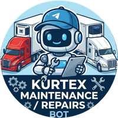

&nbsp;&nbsp;&nbsp;

# Kurtex Alert Bot

### Fleet Maintenance Dispatch, Case Tracking & Real-Time Operations on Telegram

  
  
  
  

  <strong>Fast, reliable Telegram command center connecting drivers, maintenance agents, dispatch managers, and Kurtex Desktop in real time.</strong>

&nbsp;

---

## Overview

**Kurtex Alert Bot** monitors fleet driver groups for breakdown and repair alerts, routes them straight to on-duty maintenance personnel in private Telegram chats, guides agents through structured case reporting and part-number tracking, and synchronizes every update live with **Kurtex Desktop**.

Built for busy 24/7 trucking operations where multiple agents manage stacked cases simultaneously without delays, missed alerts, or chat clutter.

---

## Key Capabilities

| Area | What It Delivers |
| :--- | :--- |
| **Instant Alert Capture** | Automatically detects driver maintenance alerts posted in fleet groups with `#maintenance`, `#repairs`, or `#repair` (text or photo captions). |
| **Smart Shift Routing** | Routes incoming alerts exclusively to agents and managers currently on duty based on configurable schedules and timezones managed in Kurtex Desktop. |
| **Zero-Flood Case Queue** | Manages large case backlogs cleanly with paginated cards and an ultra-fast **Compact List** mode (10 cases in a single message) plus instant filters (`All`, `Non-Reported`, `Reported`). |
| **Streamlined Chat Reporting** | Guided step-by-step report flow inside Telegram DM featuring 1-tap driver/issue prefills, dynamic Truck / Trailer / Reefer fields, and draft preservation. |
| **Part Replacement History** | Prompts for replaced component part numbers when closing a case so maintenance history stays searchable across Kurtex AI & Desktop. |
| **Escalations & Daily Digest** | Automatically reminds the team when an alert sits unassigned too long and posts a scheduled end-of-day performance summary. |
| **Built-In Support & Broadcasts** | Users can report bot errors or ask for help anytime with instant delivery to the Desktop **Bot Reports** tab, while managers/developers can broadcast system-wide alerts. |

---

## Telegram Commands

### Agent & Operations Commands

| Command | Purpose |
| :--- | :--- |
| `/start` | Register your Telegram profile and check your assigned access role |
| `/mycases` | Browse, filter, report, reassign, or close active cases (Card View or Compact List) |
| `/unassigned` | View untouched alerts waiting for an agent and claim them with one tap |
| `/done` | View cases you resolved today |
| `/casehistory` | Browse your full closed case archive with notes and replaced part numbers |
| `/mystats` | View your personal assigned, active, weekly, and all-time metrics |
| `/shifts` | Check who is currently on duty and view active shift schedules |
| Dashboard → Report & Support | Submit bugs, suggestions and support requests directly to developers (not a Telegram command) |
| `/help` | View available commands and quick-report button for your role |

### Manager & Developer Commands

| Command | Purpose |
| :--- | :--- |
| `/alert` | Compose, preview, and broadcast a system notice (maintenance, restart, update) to all users |
| `/report` | Generate an on-demand daily summary report |
| `/leaderboard` | View weekly agent performance rankings |
| `/missed` | Inspect alerts that went unhandled past escalation thresholds |
| `/listusers` | View all authorized team members and their roles |
| `/adduser` / `/removeuser` / `/editrole` | Manage team access and roles *(tip: forward any user message to add them quickly)* |

---

## How a Case Flows End-to-End

| Step | Stage | What Happens |
| :---: | :--- | :--- |
| **1** | **Alert Triggered** | A driver posts `#maintenance`, `#repairs`, or `#repair` in the fleet group. |
| **2** | **On-Duty Dispatch** | The bot creates a case and alerts currently scheduled on-duty team members in DM. |
| **3** | **Single-Agent Claim** | One agent taps **Assign** to lock the case cleanly and prevent duplicate handling. |
| **4** | **Report or Resolve** | Agent submits the guided **Report** (Truck / Trailer / Reefer), **Reassigns** if needed, or taps **Solve** with optional replaced part numbers — synced live with **Kurtex Desktop**. |

---

## Desktop Integration & Data Reliability

* **Shared High-Speed Database:** Cases, users, shift schedules, and support tickets live in a single transactional database engineered for concurrent bot and dashboard access without file lock delays.
* **Non-Destructive Upgrades:** Legacy records import automatically without deleting historical backups.
* **Live Synchronization:** Every assignment, report, status move, note, shift edit, and support ticket stays synchronized with **Kurtex Desktop**.
* **Role-Based Access:** Separate permissions for **Agents**, **Managers**, and **Developers** keep operational views clean and administrative tools protected.

---

  Kurtex Fleet Operations · Automated Telegram Dispatch &amp; Maintenance Tracking

